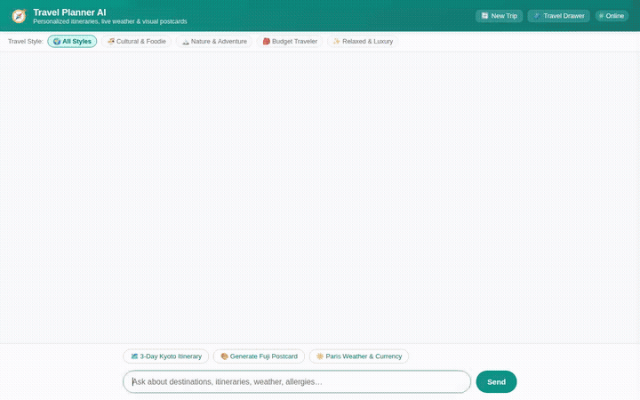

# ✈️ Travel Planner Agent



A conversational travel planning agent that assists travelers in discovering destinations, assembling personalized itineraries, and exploring locations with generative visual media. Built with the **Agent Development Kit (ADK)** and powered by **Gemini 2.5**, the agent maintains persistent cross-session memory of traveler preferences and dietary needs, queries live external APIs, persists catalog data, and renders structured card-based user interfaces.

---

## 🌟 What This Agent Does

The agent acts as an interactive travel companion that combines conversational reasoning with real-time tool orchestration:

- **Personalized Itinerary Assembly**: Creates detailed multi-day travel itineraries customized to traveler pace, interests, budget, and dietary requirements.
- **Dietary & Preference Memory**: Recalls traveler preferences and strict food allergies across different conversations, automatically filtering culinary suggestions.
- **Generative Media Creation**:
  - Produces custom destination illustrations and postcards using Google's **Nano Banana 2 Lite** (`gemini-3.1-flash-lite-image`).
  - Generates scenic video clips of destinations and landmarks using Google's **Omni model** (`gemini-omni-flash-preview`).
  - Publishes media directly to Google Cloud Storage and displays them in-chat with an image lightbox.
- **Real-Time Data Integration**:
  - Fetches real-time weather forecasts and temperatures via Open-Meteo.
  - Converts travel currencies and daily budgets via Frankfurter API.
  - Looks up coordinates and nearby points of interest (attractions, restaurants, cafes) via Google Maps Places and Geocoding APIs.
  - Queries local destination time zones.
- **Catalog & Itinerary Persistence**: Queries and saves destinations and planned traveler itineraries in Google Cloud Firestore.
- **Secure Code Sandbox**: Executes Python calculations for currency conversions, budget splits, and scheduling in a sandboxed runtime.
- **A2UI Visual Cards**: Emits structured A2UI (Agent-to-User Interface) components (cards, rows, columns, and images) rather than raw text blocks.

---

## ☁️ Google Cloud & AI Services Wired Up

This project directly integrates the following Google Cloud and Agent Platform components:

| Service / Tool | Model / Technology | Implementation in Code |
|---|---|---|
| **Core Reasoning Agent** | `gemini-2.5-flash` via ADK | Main agent reasoning loop in `app/agent.py` communicating via A2A protocol. |
| **Long-Term Memory Bank** | Vertex AI Memory Bank | `PreloadMemoryTool` preloads traveler preferences at turn start; `generate_memories_callback` persists new facts after agent execution. |
| **NoSQL Database** | Google Cloud Firestore | Native Firestore collection `destinations` used by `list_destinations`, `search_destinations`, `save_destination`, and `save_traveler_itinerary`. |
| **Object Storage** | Google Cloud Storage | Public cloud bucket hosting generated postcards and video files for web display. |
| **Image Generation** | `gemini-3.1-flash-lite-image` | Generates scenic destination illustrations, saves ADK artifacts, and uploads public image URLs. |
| **Video Generation** | `gemini-omni-flash-preview` | Google Omni model generates short destination highlight videos using the Interactions API. |
| **Code Execution Sandbox** | Vertex AI Code Execution Sandbox | `AgentEngineSandboxCodeExecutor` runs calculations securely in isolated environments. |
| **Rich Interface (A2UI)** | A2UI v0.8 Specifications | `a2ui_callback` converts structured agent outputs into native interactive cards, rendered by the custom web frontend. |
| **Web Frontend Proxy** | FastAPI + Cloud Run | Lightweight proxy connecting the browser chat client to the deployed agent over the A2A protocol. |

---

## 🛠️ Implemented Agent Tools

The agent has 12 functions registered in `app/agent.py`:

1. `PreloadMemoryTool` — Retrieves long-term traveler memory and allergies prior to reasoning.
2. `generate_destination_image` — Creates custom postcards/illustrations (`gemini-3.1-flash-lite-image`).
3. `generate_destination_video` — Generates scenic attraction video highlights (`gemini-omni-flash-preview`).
4. `get_live_destination_weather` — Queries current temperature and weather conditions (Open-Meteo API).
5. `convert_currency` — Real-time currency conversion for travel expenses (Frankfurter API).
6. `geocode_address` — Resolves destination addresses into latitude and longitude coordinates.
7. `find_nearby_places` — Finds attractions, cafes, museums, and restaurants around coordinates.
8. `list_destinations` — Fetches curated destination entries from Firestore filtered by category.
9. `search_destinations` — Full-text keyword search across Firestore destination entries.
10. `save_destination` — Adds or updates a destination in the Firestore collection.
11. `save_traveler_itinerary` — Saves structured traveler itineraries in Firestore.
12. `get_current_time` — Resolves destination local time across worldwide time zones.

---

## 📁 Repository Structure

```
.
├── assets/
│   └── demo.gif                     # Looping demo recording of the web interface
├── travel-planner/
│   ├── agents-cli-manifest.yaml     # Agent deployment manifest
│   ├── pyproject.toml               # Agent dependencies and metadata
│   ├── app/
│   │   ├── agent.py                 # Core agent definition, prompt, and 12 tools
│   │   └── app_utils/
│   │       └── a2ui_utils.py        # A2UI callback and card generation helpers
│   ├── frontend/
│   │   ├── main.py                  # FastAPI proxy (browser -> agent via A2A)
│   │   ├── requirements.txt         # Frontend runtime dependencies
│   │   └── static/
│   │       ├── index.html           # Branded chat UI with prompt chips & lightbox
│   │       ├── style.css            # Stylesheet and responsive layout
│   │       └── app.js               # Message streaming and A2UI card renderer
│   ├── tests/                       # Unit and integration tests
│   └── seed_destinations.py         # Seed script for initial Firestore catalog
├── project_brief.md                 # Original project brief and tool coverage checklist
└── README.md
```

---

## 🚀 Setup & Local Run Instructions

### 1. Prerequisites

- Python 3.11+
- `uv` (recommended package manager) or `pip`
- Google Cloud SDK (`gcloud`) authenticated with your project:
  ```bash
  gcloud auth login
  gcloud auth application-default login
  gcloud config set project <YOUR_PROJECT_ID>
  ```

### 2. Run the Agent Locally (ADK Playground)

To test the agent logic and tools in the ADK development UI:

```bash
cd travel-planner
agents-cli install
agents-cli playground
```

Open the printed development server URL in your browser to interact with the agent.

### 3. Run the Custom Web Frontend

The custom frontend connects to the agent using the Agent-to-Agent (A2A) protocol.

```bash
cd travel-planner/frontend

# Create and activate virtual environment
python3 -m venv .venv
source .venv/bin/activate

# Install frontend dependencies
pip install -r requirements.txt

# Set the deployed Agent Engine resource name or local endpoint
export AGENT_ENGINE_RESOURCE_NAME="<YOUR_AGENT_ENGINE_RESOURCE_NAME>"
export AGENT_DIRECTORY="app"

# Start the frontend proxy
python main.py
```

The frontend server starts on port `8080`.
